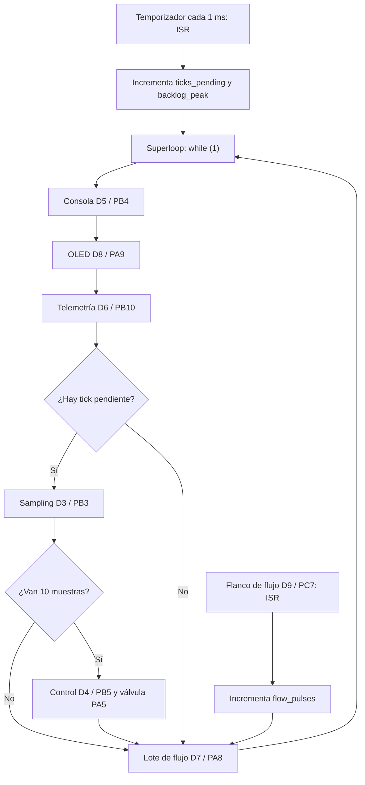

# RET — Informe de Evidencia de Tiempos

- **Equipo:** María de los Ángeles Prieto · Rafael Torres Choperena · Mariana Zuluaga Yepes
- **Plataformas:** Nucleo-L476RG y ESP32-C6 Super Mini
- **MCU final:** ESP32-C6FH4, RISC-V, 160 MHz, 4 MB flash
- **Sistema operativo:** Zephyr RTOS 4.4.99
- **Aplicación:** SoilSense Control

Documento vivo y acumulativo. Toda afirmación temporal se respalda con una medición.

## 1. Sistema y conjunto de tareas

### Requisitos temporales

| ID | Requisito |
|---|---|
| REQ-SAMP-01 | Mientras el sistema esté encendido, deberá ejecutar muestreo, comprobación de parada de emergencia y fase PWM cada 1 ms, con deadline igual al periodo. |
| REQ-CTRL-01 | Mientras el sistema esté irrigando, deberá ejecutar el controlador PI cada 10 ms, con deadline igual al periodo. |
| REQ-CONS-01 | Cuando el operador envíe un comando válido, el sistema deberá interpretarlo y responder por consola. |
| REQ-TELE-01 | Mientras el sistema funcione, deberá emitir telemetría aproximadamente cada segundo. |
| REQ-FLOW-01 | Cuando llegue un pulso de flujo, deberá registrarlo y procesar cada lote de 100 pulsos. |
| REQ-HMI-01 | Mientras la HMI esté habilitada, deberá actualizar la pantalla cada 500 ms. |
| REQ-SAFE-01 | Cuando se detecte sobrepresión o parada de emergencia, deberá llevar la válvula al estado seguro cerrado. |

### Tareas y tiempos de ejecución

Las mediciones del ESP32-C6 se obtuvieron mediante `k_cycle_get_32()`. Al no disponer de analizador lógico en Lab 3, se usó instrumentación interna, que es intrusiva y no sustituye perfectamente una captura externa.

| Tarea | Requisito | Tipo | Periodo | Deadline | C_i máximo | Método |
|---|---|---:|---:|---:|---:|---|
| Sampling | REQ-SAMP-01 | Hard | 1 ms | 1 ms | 12.937 µs | Contador de ciclos interno |
| Control PI | REQ-CTRL-01 | Hard | 10 ms | 10 ms | 34.500 µs | Contador de ciclos interno; puede incluir preempción |
| Consola | REQ-CONS-01 | Firm | Esporádica | No definido | 408.623 ms durante `calib` | Contador de ciclos |
| Telemetría | REQ-TELE-01 | Soft | 1 s | Flexible | 50.442 ms | Contador alrededor de `snprintf` y `printk` |
| Flow batch | REQ-FLOW-01 | Soft | Cada 100 pulsos | No definido | No medido en C6 | No se generaron pulsos |
| Pantalla OLED | REQ-HMI-01 | Soft | 500 ms | 500 ms | 25.06 ms en Nucleo | Ancho de pulso D8 con Logic 2 |

Valores de Lab 2 en Nucleo-L476RG: sampling 5.0 µs, control 2.5 µs, `help` 1.313 ms, telemetría 6.1555 ms, flow batch 70.5 µs, OLED 25.06 ms y latencia de flujo 12.5 µs.

## 2. ADRs

### ADR-001 — Port mediante devicetree

**Contexto:** la aplicación debía pasar de Nucleo-L476RG a ESP32-C6 Super Mini.  
**Decisión:** mantener el C independiente de la placa y describir el C6 mediante un overlay.  
**Justificación:** el port dedicado añadió un overlay de 103 líneas y cero cambios de C.  
**Estado:** aceptada e implementada.

Evidencia: commits `8f67887` y `c54327c`; detección correcta del ESP32-C6FH4 con 4 MB y consola USB Serial/JTAG funcional.

### ADR-002 — Mover sampling a un thread preventivo

**Contexto:** consola, telemetría y `calib` impedían que el superloop atendiera sampling cada 1 ms.  
**Decisión:** mover solo sampling a un thread Zephyr de prioridad 2, bloqueado en una `k_msgq`; mantener `main` en prioridad 10.  
**Justificación:** con `calib`, el jitter pasó de 408.297 ms a 2 µs y el backlog de 409 a 0.  
**Consecuencia:** sampling queda protegido, pero control continúa bloqueado en `main`.  
**Estado:** aceptada como migración intermedia.

## 3. Evidencia por semana

### Semana 1 — Preparación y trazabilidad del entorno

Se creó y verificó el repositorio `4101137-real-time-systems`, se instaló el entorno virtual de Zephyr y se confirmó `west` versión 1.5.0. El workspace quedó ubicado en `/home/maria/zephyrproject` y el entorno se activa con `source "$HOME/zephyrproject/.venv/bin/activate"`. Se verificaron compilación, control de versiones y conexión USB de la placa. Esta preparación permitió conservar cada cambio posterior como evidencia reproducible.

### Semana 2 — Superloop en Nucleo-L476RG

**Instrumento:** Saleae Logic 2.  
**Señales:** D3 sampling, D4 control, D5 consola, D6 telemetría, D7 lote de flujo, D8 OLED y D9 entrada de flujo.

#### Arquitectura observada



La ISR del temporizador no ejecuta sampling: incrementa `ticks_pending`. El superloop atiende consola, OLED y telemetría antes de revisar ese contador. Cada diez muestras ejecuta control. La ISR de flujo incrementa `flow_pulses` y el lote se procesa en el bucle. Por ello, cualquier tarea lenta retrasa a todas las que aparecen después.

| Medición | Resultado |
|---|---:|
| Periodo promedio de sampling | 999 µs |
| Periodo máximo normal con OLED/cache | 23.870 ms |
| Jitter máximo normal | 22.870 ms |
| Periodo máximo sin cache | 25.580 ms |
| Jitter máximo sin cache | 24.580 ms |
| Duración de `calib` | 408.882 ms |
| Periodo máximo durante `calib` | 432.332 ms |
| Jitter durante `calib` | 431.332 ms |
| `backlog_peak` durante `calib` | 432 ticks |

El superloop incumplió el deadline de 1 ms cuando una operación blanda o bloqueante ocupó su único flujo de ejecución. Al terminar, procesó ticks atrasados casi consecutivamente, pero recuperar trabajo no equivale a cumplir deadlines.

#### Causa raíz de `calib`

`cmd_calib()` ejecuta `k_busy_wait(400)` dentro de 1000 iteraciones. Como el comando se invoca sincrónicamente desde `console_handle()` dentro del único `while (1)`, el programa permanece aproximadamente 400 ms sin atender `ticks_pending`. El resultado medido fue un periodo máximo de sampling de 432.332 ms, jitter de 431.332 ms y crecimiento de `backlog_peak` de 30 a 432 ticks.

### Semana 3 — ESP32-C6 y primer thread

La guía usa un ESP32-S3, pero este equipo trabajó con un ESP32-C6 Super Mini según el hardware asignado. El concepto evaluado se conserva: port por devicetree y migración de sampling a un thread.

| Medición | Nucleo Lab 2 | C6 superloop | C6 + sampling thread |
|---|---:|---:|---:|
| Jitter máximo normal | 22,870 µs | 50,446 µs | **2 µs** |
| Periodo máximo normal | 23,870 µs | 51,446 µs | **1,001 µs** |
| Jitter con `calib` | 431,332 µs | 408,297 µs | **2 µs** |
| Periodo máximo con `calib` | 432,332 µs | 409,297 µs | **1,001 µs** |
| `backlog_peak` con `calib` | 432 | 409 | **0** |
| `lat_peak_us` | — | — | **9 µs** |
| Periodo máximo de control con `calib` | — | 416.317 ms | **420.004 ms** |
| Duración de `calib` | 408.882 ms | 407.482 ms | 408.516 ms |

#### C6 superloop normal, captura superior a 30 s

```text
samples=138949 controls=13894
samp_max_us=51446 samp_jitter_max_us=50446
ctrl_period_max_us=54511 backlog_peak=51
exec_max_ns samp=12312 ctrl=7312 tele=50442250
```

La relación sampling/control fue aproximadamente 10:1. La telemetría USB llegó a bloquear cerca de 50.442 ms. El mínimo de sampling cercano a 10 µs observado en otras capturas correspondió a ejecuciones consecutivas para recuperar ticks atrasados, no al periodo real del temporizador.

#### C6 superloop con `calib`

```text
backlog_peak=409
samp_max_us=409297 samp_jitter_max_us=408297
ctrl_period_max_us=416317 calib_last_us=407482
console_exec_max_ns=408622875
```

Sampling y control quedaron bloqueados durante la calibración porque compartían el mismo bucle.

#### C6 con sampling thread normal, captura de 49.164 s

```text
samples=49164 controls=4916
samp_max_us=1001 samp_jitter_max_us=2
ctrl_period_max_us=13098
backlog_peak=0 lat_peak_us=9
exec_max_ns samp=3187 ctrl=34500
```

Sampling mantuvo su periodo y no acumuló liberaciones. Control llegó a 13.098 ms porque todavía se ejecuta en `main`.

#### C6 con sampling thread y `calib`

```text
samples=26202 controls=2619
samp_max_us=1001 samp_jitter_max_us=2
ctrl_period_max_us=420004 calib_last_us=408516
backlog_peak=0 lat_peak_us=9
exec_max_ns samp=3187 ctrl=1375
```

Durante los 408.516 ms de calibración, el thread de prioridad 2 interrumpió a `main`, de prioridad 10, en cada liberación. Sampling cumplió REQ-SAMP-01. Control no sobrevivió: `control_pending` solo se atendió cuando `main` terminó `calib`, por lo que REQ-CTRL-01 se incumplió.

### Comparación de silicios

Aunque el ESP32-C6 funciona a mayor frecuencia que el STM32L476RG, su superloop mostró un peor máximo normal: 50.446 ms frente a 22.870 ms. La frecuencia de CPU no determina por sí sola el peor caso; la consola USB Serial/JTAG, `printk`, la cache de flash y las operaciones bloqueantes dominaron la medición.

La comparación es indicativa, no perfectamente equivalente: el Nucleo se midió con analizador lógico y el C6 con instrumentación interna; además, la ruta de consola y las condiciones del OLED no fueron idénticas.

### Estado compartido introducido por el thread

| Variable | Escritores | Lectores |
|---|---|---|
| `pressure_mv` | Sampling | Control, telemetría, display y `status` |
| `estop` | Sampling/joystick y comando `clear` | Control, telemetría, display y `status` |
| `setpoint_mv` | Joystick y comando `set` | Control, telemetría, display y `status` |

Las pruebas funcionan porque el C6 tiene un solo núcleo principal y los accesos alineados a enteros naturales son indivisibles en hardware. Sin embargo, en C siguen existiendo carreras de datos. Una versión robusta deberá usar atómicos, mutexes o mensajes; `volatile` no resuelve la sincronización.

### Limitaciones de la evidencia interna

La instrumentación agrega instrucciones, tiene resolución finita, puede incluir tiempo de preempción y no observa directamente los GPIO. Las mediciones críticas deberán repetirse con analizador lógico si la rúbrica exige evidencia externa. Aun así, la diferencia entre 408.297 ms y 2 µs demuestra claramente el efecto arquitectónico.

### Trazabilidad

| Commit | Contenido |
|---|---|
| `d792e29` | Línea base del superloop |
| `8f67887` | Port del superloop al C6 Super Mini |
| `fe33e47` | Métricas internas del superloop |
| `c54327c` | Port de sampling thread al C6 Super Mini |
| `3586dc4` | Métricas internas del sampling thread |

## 4. Análisis preliminar de planificabilidad

Con máximos conservadores:

- Sampling: \(C_s=12.937\ \mu s\), \(T_s=1000\ \mu s\)
- Control: \(C_c=34.500\ \mu s\), \(T_c=10000\ \mu s\)

\[
U=\frac{12.937}{1000}+\frac{34.500}{10000}=0.016387\approx1.639\%
\]

Para dos tareas, el límite RM es aproximadamente 82.84 %, por lo que la demanda de CPU es baja. Sin embargo, esta prueba no demuestra la planificabilidad completa: control no es todavía un thread periódico y sufre bloqueo por `calib`. La evidencia experimental muestra un periodo de 420.004 ms frente a un deadline de 10 ms.

**Veredicto:** REQ-SAMP-01 se cumple con el thread; REQ-CTRL-01 no se cumple durante `calib`. El siguiente paso es migrar control a una entidad temporal independiente y realizar RTA incluyendo bloqueos.

## 5. Seguridad funcional

El estado seguro es válvula cerrada (`duty_pct=0`). Sampling detecta sobrepresión a 1 kHz, pero el cierre se aplica cuando control vuelve a ejecutarse. Como control puede retrasarse unos 420 ms durante `calib`, todavía no existe una latencia segura garantizada.

Acciones pendientes:

- migrar la reacción crítica para que no dependa de `main`;
- definir el deadline máximo de cierre;
- añadir watchdog y demostrar su actuación;
- sincronizar el estado compartido;
- repetir mediciones críticas con analizador lógico;
- completar RTA después de migrar control.
