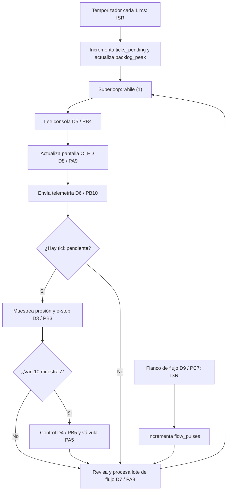
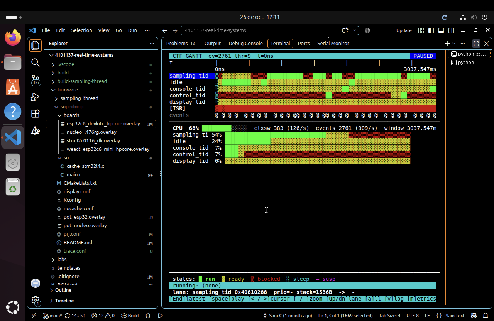
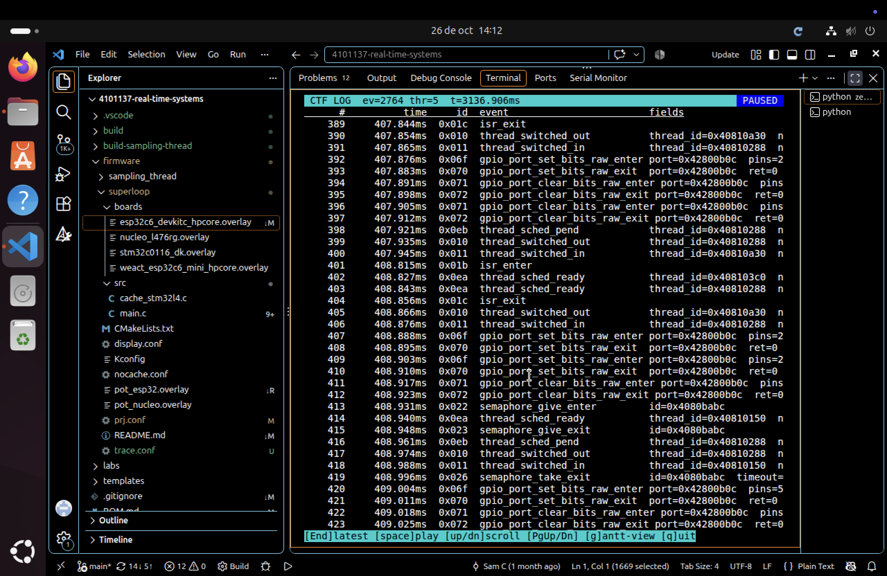
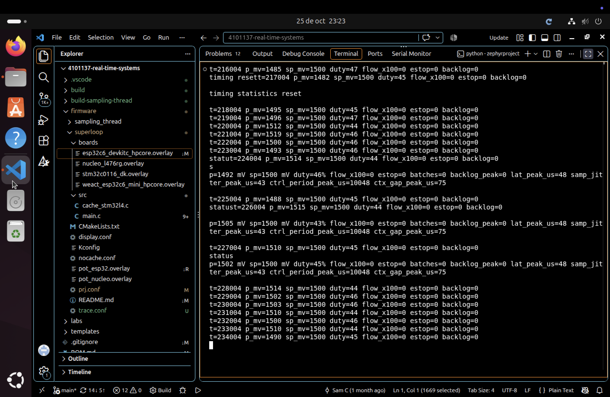
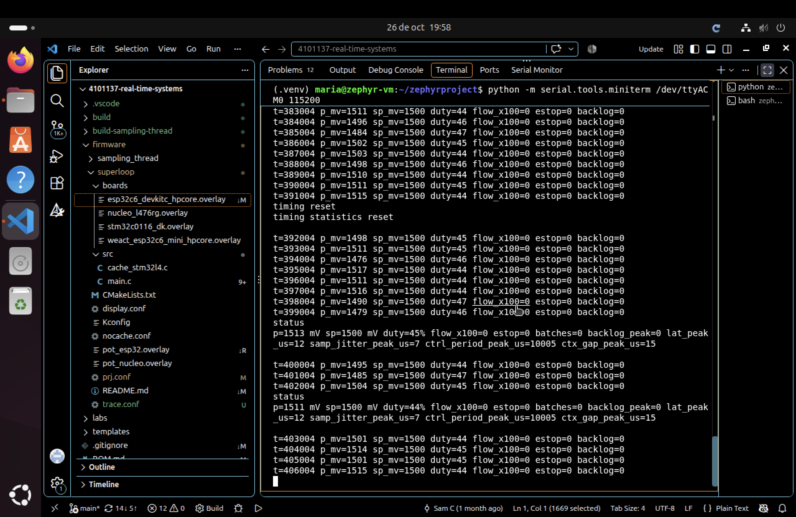

# RET — Informe de Evidencia de Tiempos

**Grupo:** `María Prieto Ortega` · `Mariana Zuluaga Yepes`  
**Placas:** `Nucleo-L476RG` · `ESP32-C6 Super Mini`

## 1. El sistema y su conjunto de tareas

| ID | Requisito |
|---|---|
| REQ-SAMP-01 | Mientras el sistema está activo, deberá ejecutar el muestreo de presión y e-stop cada 1 ms, dentro de un plazo de 1 ms. |
| REQ-CTRL-01 | Mientras el sistema está irrigando, deberá ejecutar el control cada 10 ms, dentro de un plazo de 10 ms. |
| REQ-CONS-01 | Cuando el operador ingrese un comando válido, el sistema deberá procesarlo y mostrar la respuesta correspondiente en la consola. |
| REQ-TEL-01 | Mientras el sistema está activo, deberá publicar telemetría cada 1 s. |
| REQ-HMI-01 | Mientras la HMI está habilitada, deberá actualizar la pantalla cada 500 ms. |
| REQ-FLOW-01 | Cuando se acumulen 100 pulsos de flujo, deberá procesar el lote en la siguiente iteración disponible. |
| REQ-SAFE-01 | Si se presenta una sobrepresión o se activa la parada de emergencia, el sistema deberá cerrar la válvula para garantizar la seguridad. |

### Tareas y tiempos de ejecución en Nucleo-L476RG — Lab 2

| Tarea | Requisito | Tipo | Período o activación | Deadline | `C_i` observado | Instrumento |
|---|---|---|---|---|---:|---|
| Muestreo | REQ-SAMP-01 | Duro | 1 ms | 1 ms | 5 µs | Ancho de pulso D3, analizador lógico y Logic 2 |
| Control | REQ-CTRL-01 | Duro | 10 ms | 10 ms | 2,5 µs | Ancho de pulso D4, analizador lógico y Logic 2 |
| Consola (`help`) | REQ-CONS-01 | Firme | Por evento | No definida | 1,313 ms | Ancho de pulso D5, analizador lógico y Logic 2 |
| Telemetría | REQ-TEL-01 | Suave | 1 s | 1 s | 6,1555 ms | Ancho de pulso D6, analizador lógico y Logic 2 |
| Lote de flujo | REQ-FLOW-01 | Firme | Cada 100 pulsos | No definida | 70,5 µs | Ancho de pulso D7, analizador lógico y Logic 2 |
| Pantalla OLED | REQ-HMI-01 | Suave | 500 ms | 500 ms | 25,06 ms | Ancho de pulso D8, analizador lógico y Logic 2 |

### Tareas y tiempos de ejecución en ESP32-C6 — Lab 3

| Tarea | Requisito | Tipo | Período o activación | Deadline | `C_i` máximo medido | Instrumento |
|---|---|---|---|---|---:|---|
| Muestreo | REQ-SAMP-01 | Duro | 1 ms | 1 ms | 12,937 µs | Contador interno `k_cycle_get_32()` |
| Control PI | REQ-CTRL-01 | Duro | 10 ms | 10 ms | 34,500 µs | Contador interno `k_cycle_get_32()` |
| Consola (`calib`) | REQ-CONS-01 | Firme | Esporádica | No definido | 408,623 ms | Contador interno `k_cycle_get_32()` |
| Telemetría USB | REQ-TEL-01 | Suave | 1 s | Flexible | 50,442 ms | Contador interno `k_cycle_get_32()` |
| Lote de flujo | REQ-FLOW-01 | Firme | Cada 100 pulsos | No definido | No medido | No disponible |
| Pantalla OLED | REQ-HMI-01 | Suave | 500 ms | 500 ms | No medido | No disponible |

### Tareas y tiempos de ejecución en ESP32-C6 — Labs 4 y 5

En Zephyr, un número de prioridad menor representa una prioridad más alta.

| Tarea | Requisito | Prioridad | Período o activación / deadline | `C_i` máximo medido | Instrumento |
|---|---|---:|---|---:|---|
| `sampling_tid` | REQ-SAMP-01 | 2 | 1 ms / 1 ms | 12 µs | Contador interno `k_cycle_get_32()` |
| `control_tid` | REQ-CTRL-01 | 3 | 10 ms / 10 ms | 5 µs | Contador interno `k_cycle_get_32()` |
| `flow_wq` | REQ-FLOW-01 | 5 | Cada 100 pulsos / no definido | 165 µs | Contador interno `k_cycle_get_32()` |
| `display_tid` | REQ-HMI-01 | 7 | 500 ms / 500 ms | No medido | No disponible |
| `telemetry_tid` | REQ-TEL-01 | 8 | 1 s / 1 s | 165 µs | Contador interno `k_cycle_get_32()` |
| `console_tid` | REQ-CONS-01 | 9 | Esporádica / no definido | 400,030 ms | Contador interno `k_cycle_get_32()` |

## Tareas de los laboratorios

### Diagrama del superloop — Lab 2, tarea A



### Lectura del flujo

- El temporizador genera una interrupción cada 1 ms. La ISR no ejecuta directamente el muestreo: incrementa `ticks_pending` y actualiza `backlog_peak` cuando se acumulan ticks.

- El superloop recorre siempre el mismo orden: consola, pantalla OLED y telemetría. Después revisa si hay un tick de muestreo pendiente.

- Si existe un tick pendiente, ejecuta el muestreo de presión y e-stop en D3. Cada diez muestras ejecuta además el control en D4 y actualiza la válvula en PA5.

- La entrada de flujo llega por D9/PC7. Su ISR incrementa `flow_pulses`; el superloop revisa ese contador en la tarea de lote de flujo, instrumentada en D7.

- La tarea de flujo se revisa en cada vuelta del ciclo. Cuando no hay un tick pendiente, el superloop pasa directamente desde la telemetría hacia la revisión de flujo.

- Como todas las tareas comparten un único `while (1)`, una tarea lenta bloquea temporalmente a las demás. La actualización de la OLED y el comando `calib` pueden retrasar el muestreo y acumular `ticks_pending`.

## 2. ADRs

### ADR-001 — Arquitectura del nodo con kernel multihilo

**Contexto:** En la línea base del superloop de la ESP32-C6, el comando `calib` bloqueó muestreo y control durante aproximadamente 408 ms. El jitter máximo de muestreo alcanzó 408,297 ms, el período máximo de control alcanzó 416,317 ms y se acumularon 409 ticks.

**Decisión:** Migrar todas las tareas del superloop a entidades del kernel de Zephyr. Muestreo se ejecuta en `sampling_tid`; control en `control_tid`; flujo se procesa en la cola de trabajo privada `flow_wq`; pantalla, telemetría y consola se ejecutan en sus propios hilos. `main` solamente inicializa el hardware, inicia el temporizador y retorna.

**Justificación:** En la versión con kernel y sin tracing, incluso durante `calib`, el jitter máximo de muestreo fue 7 µs, el período máximo de control fue 10,005 ms y `backlog_peak` permaneció en 0. Esto elimina el bloqueo de aproximadamente 408 ms que afectaba las tareas críticas en el superloop.

**Costo:** La transición desde la liberación de control hasta su inicio tuvo un máximo de 15 µs. Como control se libera 100 veces por segundo, el costo estimado es:

\[
100 \times 15\ \mu s = 1500\ \mu s/s = 1,5\ ms/s
\]

**Estado:** Aceptada e implementada.

### ADR-002 — Captura CTF en RAM para el ESP32-C6

**Contexto:** La guía original del Lab 5 utiliza un ESP32-S3 con dos conexiones USB: una para consola y otra para transmitir CTF por UART a 4 Mbaud. El ESP32-C6 Super Mini disponible posee una única conexión USB Serial/JTAG, por lo que no es posible reproducir directamente esa separación de puertos.

**Decisión:** Configurar el backend CTF de Zephyr para almacenar los eventos en un búfer de RAM de 65 536 bytes. Después de la ejecución, el búfer se extrae mediante el JTAG integrado y GDB y se decodifica con `trace_viewer.py`.

**Justificación:** La adaptación conserva los eventos del planificador, nombres de hilos, interrupciones, cambios de contexto, semáforos y estados `ready`, `running` y `blocked`. Por tanto, permite estudiar la historia del planificador requerida por el laboratorio.

**Limitación:** La captura no se transmite continuamente. Termina cuando el búfer se llena, por lo que solamente conserva una ventana aproximada de 3,14 s. El uso de JTAG también obliga a detener temporalmente el procesador para extraer los datos.

**Estado:** Aceptada e implementada para el ESP32-C6 Super Mini.

## 3. Evidencia por semana

### Semana 2 — Línea base del superloop

**Requisitos verificados:** REQ-SAMP-01, REQ-CTRL-01 y REQ-FLOW-01.  
**Placa:** Nucleo-L476RG  
**Instrumento:** Analizador lógico con Logic 2  
**Señales:** D3 muestreo, D4 control, D5 consola, D6 telemetría, D7 lote de flujo, D8 OLED y D9 entrada de flujo.

| Medición | Valor obtenido | Referencia |
|---|---:|---|
| Período real de muestreo, promedio | **999 µs** | 1000 µs |
| Jitter máximo de muestreo durante ≥ 30 s | **22 870 µs** | Línea base con OLED y caché |
| Latencia ISR → servicio del superloop, pulso de flujo | **12,5 µs** | D9 → D7 |
| Jitter máximo de muestreo con la caché flash desactivada | **24 580 µs** | Aumentó aproximadamente 1710 µs |
| Jitter de muestreo con el comando bloqueante activo | **431 332 µs** | Comando `calib` |
| `backlog_peak`, inactivo → durante el comando bloqueante | **30 → 432 ticks** | Contador interno del firmware |

> **Criterio usado para el jitter máximo tardío**
>
> \[
> jitter = período\ máximo\ observado - 1000\ \mu s
> \]
>
> Este valor indica cuánto se retrasó la ejecución del muestreo frente a su período nominal de 1 ms.

La frecuencia media se mantuvo cercana a 1 kHz, pero la actualización de la OLED produjo huecos de hasta 25,58 ms en D3. El comando `calib` bloqueó el único superloop durante 408,882 ms, acumuló 432 ticks y retrasó tanto el muestreo como el control.

#### Análisis de causa raíz del comando `calib`

En `firmware/superloop/src/main.c`, la función `cmd_calib()` ejecuta `k_busy_wait(400)` dentro de un ciclo de 1000 rondas. Esto bloquea el superloop aproximadamente 400 ms.

El comando se invoca desde `console_handle()` y la consola se ejecuta dentro del único `while (1)`. Mientras la calibración no retorna, el programa no atiende `ticks_pending`; por ello se observó un período máximo de D3 de 432,332 ms y `backlog_peak=432`.

### Semana 3 — Comparación de la línea base del C6 y el silicio

**Requisitos verificados:** REQ-SAMP-01 y REQ-CTRL-01.

Aunque la guía está diseñada para el ESP32-S3, se utilizó un ESP32-C6 Super Mini. El objetivo de realizar el port mediante devicetree y trasladar el muestreo a un hilo de ejecución se mantuvo.

| Medición | Nucleo Lab 2 | C6 superloop | C6 + `sampling_tid` |
|---|---:|---:|---:|
| Jitter máximo normal | 22,870 ms | 50,446 ms | 2 µs |
| Período máximo normal | 23,870 ms | 51,446 ms | 1,001 ms |
| Jitter con `calib` | 431,332 ms | 408,297 ms | 2 µs |
| Período máximo con `calib` | 432,332 ms | 409,297 ms | 1,001 ms |
| `backlog_peak` con `calib` | 432 ticks | 409 ticks | 0 ticks |
| `lat_peak_us` | — | — | 9 µs |
| Período máximo de control con `calib` | — | 416,317 ms | 420,004 ms |
| Duración de `calib` | 408,882 ms | 407,482 ms | 408,516 ms |

#### Evidencia del port

El port se realizó mediante `firmware/superloop/boards/esp32c6_devkitc_hpcore.overlay`. El archivo define los GPIO de la ESP32-C6, la entrada de flujo, la válvula, las señales de instrumentación y la consola USB Serial/JTAG.

La aplicación se compiló, se grabó en la placa y respondió al comando `status`.

El primer commit de la adaptación a ESP32-C6 fue `8e72f6f`:

```text
.../esp32c6_devkitc_hpcore.overlay | 12 +++++
firmware/superloop/src/main.c       | 37 ++++++++++++++--
2 files changed, 46 insertions(+), 3 deletions(-)
```

#### Comparación de silicios

Aunque la ESP32-C6 funciona a una frecuencia mayor que la Nucleo-L476RG, su superloop tuvo mayor jitter máximo normal: 50,446 ms frente a 22,870 ms.

La frecuencia de CPU no determina por sí sola el peor caso. La consola USB, `printk`, la ejecución desde flash con caché y las tareas bloqueantes también influyen en el tiempo máximo observado.

La comparación es indicativa: la Nucleo se midió con analizador lógico y la C6 con instrumentación interna mediante `k_cycle_get_32()`.

#### Sampling frente a control durante `calib`

Durante `calib`, el hilo de muestreo mantuvo jitter máximo de 2 µs, período máximo de 1,001 ms y `backlog_peak=0`; por ello cumple REQ-SAMP-01.

Control permaneció en el superloop y alcanzó un período máximo de 420,004 ms, mayor que su deadline de 10 ms. Por tanto, REQ-CTRL-01 no se cumple durante `calib` en esta etapa.

#### Estado compartido

| Variable | Escritores | Lectores |
|---|---|---|
| `pressure_mv` | Hilo de muestreo | Control, telemetría, pantalla y `status` |
| `estop` | Hilo de muestreo y comando `clear` | Control, telemetría, pantalla y `status` |
| `setpoint_mv` | Joystick y comando `set` | Control, telemetría, pantalla y `status` |

El programa funciona en esta prueba porque la C6 tiene un solo núcleo principal y usa enteros alineados, pero en C todavía pueden existir carreras de datos.

### Semana 4 — Migración completa al kernel y comparación A/B

**Requisitos verificados:** REQ-SAMP-01 y REQ-CTRL-01.

En esta semana se completó la migración del superloop a Zephyr. Las tareas se organizaron por prioridad: `sampling_tid` (prioridad 2), `control_tid` (3), `flow_wq` (5), `display_tid` (7), `telemetry_tid` (8) y `console_tid` (9).

La ISR del temporizador publica las liberaciones de muestreo en `tick_q`. Cada décima muestra entrega el semáforo `control_sem` para liberar control. La ISR de flujo programa `task_flow_batch()` en una cola de trabajo privada. Cada hilo se bloquea mientras no tiene trabajo, por lo que no consume CPU mediante espera activa.

| Medición en ESP32-C6 | C6 superloop, semana 3 | Predicción kernel | Kernel, semana 4 |
|---|---:|---:|---:|
| Jitter máximo de muestreo | 50,446 ms | ≤ 10 µs | 7 µs |
| Jitter máximo con `calib` | 408,297 ms | ≤ 10 µs | 7 µs |
| Período máximo de control con `calib` | 416,317 ms | ≈ 10 ms | 10,005 ms |
| Latencia ISR → hilo (`lat_peak_us`) | — | ≤ 20 µs | 12 µs |
| Brecha interna liberación → inicio de control | — | ≤ 20 µs | 15 µs |
| Uso máximo de pila de `control_tid` | — | < 1024 bytes | 236/1024 bytes |

La brecha de 15 µs se obtuvo mediante instrumentación interna entre la entrega de `control_sem` y el inicio de `control_tid`. Es una aproximación al costo de despacho y cambio de contexto, pero no equivale a una medición externa mediante GPIO.

Las mediciones se realizaron en la misma ESP32-C6 y bajo las mismas condiciones: ejecución normal por al menos 30 segundos y ejecución del comando `calib`. Debido a que no se contó con un analizador lógico compatible con los pines de la C6, los valores se obtuvieron mediante instrumentación interna con `k_cycle_get_32()`.

Durante la condición normal, el kernel mantuvo `backlog_peak=0`, `samp_jitter_peak_us=7` y `ctrl_period_peak_us=10005`. Durante `calib`, los mismos máximos se conservaron.

La migración elimina el bloqueo de aproximadamente 408 ms que producía el superloop. Con el kernel, `calib` se ejecuta en el hilo de consola de menor prioridad, mientras muestreo y control continúan ejecutándose cerca de sus períodos nominales.

El período máximo de control fue 10,005 ms, es decir, 5 µs superior al deadline estricto de 10 ms. Por tanto, la medición demuestra una mejora sustancial, pero no constituye por sí sola una prueba formal de cumplimiento estricto de REQ-CTRL-01.

#### Costo del cambio de contexto

Cada diez muestras, `sampling_tid` libera `control_tid` mediante `control_sem` y luego vuelve a bloquearse. La brecha máxima medida entre la liberación y el inicio de control fue 15 µs.

Control se libera una vez cada 10 ms, es decir, 100 veces por segundo:

\[
100\ liberaciones/s \times 15\ \mu s
=1500\ \mu s/s
=1,5\ ms/s
\]

El costo máximo estimado de estas transiciones es 1,5 ms por segundo de ejecución, equivalente a aproximadamente 0,15 %.

#### Marcas de uso máximo de pila

El comando `threads`, que ejecuta `thread_analyzer_print(0)`, produjo los siguientes valores bajo ejecución con telemetría, consola, pantalla y `calib`.

| Hilo o cola | Pila usada | Pila asignada | Uso |
|---|---:|---:|---:|
| `sampling_tid` | 252 bytes | 1536 bytes | 16 % |
| `control_tid` | 236 bytes | 1024 bytes | 23 % |
| `flow_wq` | 268 bytes | 1024 bytes | 26 % |
| `display_tid` | 220 bytes | 2048 bytes | 10 % |
| `telemetry_tid` | 660 bytes | 2048 bytes | 32 % |
| `console_tid` | 804 bytes | 2048 bytes | 39 % |

El hilo más cercano a su límite fue `console_tid`, con 804 de 2048 bytes utilizados. Ninguna pila mostró riesgo de desbordamiento durante esta prueba.

### Semana 5 — Trazado del planificador y preempción

**Requisitos observados:** REQ-SAMP-01, REQ-CTRL-01 y REQ-CONS-01.

#### Plataforma e instrumento utilizado

El laboratorio se ejecutó sobre un ESP32-C6 Super Mini, compatible con la configuración `esp32c6_devkitc/esp32c6/hpcore`, usando Zephyr 4.4.99.

Debido a que la tarjeta dispone de un único puerto USB Serial/JTAG, el trazado CTF se almacenó en un búfer de RAM de 65 536 bytes y posteriormente se extrajo mediante JTAG/GDB.

La captura utilizada para el análisis contiene 2764 eventos, cinco hilos visibles y una ventana temporal de 3136,906 ms. Se identificaron `sampling_tid`, `console_tid`, `control_tid`, `display_tid` e `idle`, además de las interrupciones del sistema.



*Figura 1. Captura CTF abierta en el visor con los hilos del nodo identificados.*

#### Tabla de mediciones

| Medición | Predicción | Valor obtenido | Contraste |
|---|---:|---:|---|
| Cambio de contexto en la traza | 15 µs | **14 µs** | `ctx_gap_peak_us` sin tracing: **15 µs** |
| Tick ISR → inicio instrumentado del muestreo | 50 µs | **73 µs** | `lat_peak_us` sin tracing: **12 µs** |
| Carga por hilo en operación normal | — | `sampling_tid`: **56 %**; `console_tid`: **13 %**; `control_tid`: **6 %**; `display_tid`: **0 %**; `idle`: **23 %** | Suma aproximada: **98 %** por redondeo |
| Sobrecarga sobre el jitter máximo | 10 µs | **36 µs** | Tracing ON: **43 µs**; tracing OFF: **7 µs** |

La carga efectiva de CPU, excluyendo `idle`, fue aproximadamente 75 %. Los porcentajes de los hilos suman cerca de 98 % por el redondeo del visor; el porcentaje restante corresponde a interrupciones y eventos internos breves.

La entrada de `sampling_tid` se produjo 61 µs después de `isr_enter`. El valor de 73 µs corresponde al inicio efectivo del trabajo instrumentado, identificado por la elevación de `instr_samp`.

#### Rastro anotado de una decisión de preempción

La siguiente secuencia fue extraída de la captura CTF alrededor de `t = 408,815 ms`.

| Tiempo | Evento | Interpretación |
|---:|---|---|
| 408,815 ms | `isr_enter` | Entra la interrupción periódica. |
| 408,827 ms | `thread_sched_ready` → `console_tid` | La consola queda lista, pero todavía no está ejecutándose. |
| 408,843 ms | `thread_sched_ready` → `sampling_tid` | La ISR libera el trabajo periódico de muestreo. |
| 408,856 ms | `isr_exit` | Finaliza la interrupción. |
| 408,866 ms | `thread_switched_out` → `idle` | El procesador abandona `idle`. |
| 408,876 ms | `thread_switched_in` → `sampling_tid` | El planificador selecciona muestreo por encima de la consola lista. |
| 408,888 ms | `gpio_port_set_bits_raw_enter` | Se eleva `instr_samp`; comienza el trabajo de muestreo. |
| 408,931 ms | `semaphore_give_enter` | Muestreo libera el semáforo de control. |
| 408,940 ms | `thread_sched_ready` → `control_tid` | Control queda listo. |
| 408,948 ms | `semaphore_give_exit` | Termina la liberación del semáforo. |
| 408,961 ms | `thread_sched_pend` → `sampling_tid` | Muestreo termina su activación y queda pendiente. |
| 408,974 ms | `thread_switched_out` → `sampling_tid` | Muestreo abandona la CPU. |
| 408,988 ms | `thread_switched_in` → `control_tid` | El procesador pasa a control. |
| 408,996 ms | `semaphore_take_exit` | Control recibe el semáforo. |
| 409,004 ms | `gpio_port_set_bits_raw_enter` | Comienza el trabajo instrumentado de control. |
| 409,031 ms | `semaphore_take_enter` | Control espera la siguiente liberación. |
| 409,038 ms | `semaphore_take_blocking` | El semáforo no está disponible y control se bloquea. |
| 409,050 ms | `thread_sched_pend` → `control_tid` | El planificador retira control. |
| 409,064 ms | `thread_switched_out` → `control_tid` | Finaliza la ejecución de control. |
| 409,077 ms | `thread_switched_in` → `console_tid` | La CPU se entrega finalmente a la consola. |

La cadena observada fue:

```text
ISR
→ console_tid ready
→ sampling_tid ready
→ sampling_tid running
→ control_tid ready
→ sampling_tid blocked
→ control_tid running
→ control_tid blocked
→ console_tid running
```

La captura muestra directamente una decisión de prioridad: aunque `console_tid` estaba listo, el planificador entregó primero la CPU a `sampling_tid`. Posteriormente, `control_tid` se ejecutó antes de regresar a la consola.

En el instante inicial de esta ventana el hilo que ejecutaba antes de la ISR era `idle`, no `console_tid`. Por tanto, la captura demuestra la preempción de `idle` y el aplazamiento de una consola lista, pero no una interrupción de `console_tid` mientras esta estaba ejecutándose.



*Figura 2. Rastro CTF anotado con ISR, estados ready, cambios de hilo, ejecución de muestreo, liberación de control y retorno a consola.*

#### Décimo tick y activación del controlador

En el tick correspondiente a la activación de control se observó:

| Tiempo | Evento |
|---:|---|
| 408,931 ms | `semaphore_give_enter` |
| 408,940 ms | `control_tid` pasa a estado ready |
| 408,948 ms | `semaphore_give_exit` |
| 408,961 ms | `sampling_tid` queda pendiente |
| 408,988 ms | `control_tid` entra en ejecución |

Por tanto, en el décimo tick, `k_sem_give()` hace que `control_tid` quede listo. Después de que `sampling_tid` termina su activación, el planificador selecciona al controlador.

#### Comparación entre tracing e instrumentación interna

El cambio de contexto se calculó entre la salida de `sampling_tid` a 408,974 ms y la entrada de `control_tid` a 408,988 ms:

\[
C_{ctx}=408,988-408,974
=0,014\ ms
=14\ \mu s
\]

La latencia entre la entrada de la ISR y la entrada de `sampling_tid` fue:

\[
L_{ISR\rightarrow sampling}
=408,876-408,815
=0,061\ ms
=61\ \mu s
\]

Tomando como inicio efectivo la elevación de `instr_samp`, la latencia fue:

\[
L_{ISR\rightarrow instr\_samp}
=408,888-408,815
=0,073\ ms
=73\ \mu s
\]

El valor obtenido mediante tracing es mayor que `lat_peak_us=12 µs`, medido con el firmware sin tracing. Esto ocurre porque el tracing registra eventos del kernel, llamadas GPIO y cambios de estado, añadiendo trabajo a la ejecución.

Además, los puntos de medición no representan exactamente el mismo instante. `lat_peak_us` mide la latencia interna definida por el firmware, mientras CTF permite observar la secuencia completa del planificador.

En la ESP32-C6 no se dispuso de una captura externa simultánea mediante analizador lógico. Por ello, la comparación se realiza entre la traza CTF y los contadores internos del firmware. Los datos del Lab 2 obtenidos con Logic 2 pertenecen a la Nucleo-L476RG y no constituyen una medición simultánea del C6.

#### Precio de observar el sistema

| Magnitud | Tracing activado | Tracing desactivado | Incremento |
|---|---:|---:|---:|
| `lat_peak_us` | 48 µs | 12 µs | **+36 µs** |
| `samp_jitter_peak_us` | 43 µs | 7 µs | **+36 µs** |
| `ctrl_period_peak_us` | 10 048 µs | 10 005 µs | **+43 µs** |
| `ctx_gap_peak_us` | 75 µs | 15 µs | **+60 µs** |

La sobrecarga máxima sobre el jitter de muestreo fue:

\[
\Delta J_{max}=43-7=\boxed{36\ \mu s}
\]

El tracing incrementó el trabajo ejecutado en cada activación y elevó la latencia, el jitter y las brechas observadas. Esto confirma que el tracing permite explicar la historia del planificador, pero también perturba el sistema observado.



*Figura 3. Resultado con tracing activado: `samp_jitter_peak_us=43`.*



*Figura 4. Resultado con tracing desactivado: `samp_jitter_peak_us=7`.*

#### Alcance del búfer de trazado

El búfer CTF alcanzó aproximadamente `pos=65331` y `buffer_full=true`, frente a una capacidad configurada de 65 536 bytes. Por esta razón, la captura disponible cubrió aproximadamente 3,14 s.

En la configuración original del ESP32-S3 solamente sobreviven cerca de 75 ms de `calib` porque el hilo encargado de drenar el tracing tiene prioridad baja. Cuando la consola ejecuta trabajo intensivo, el tracer puede quedar sin CPU y llenar su búfer.

En esta adaptación al ESP32-C6, la limitación tuvo una causa diferente: los eventos se conservaron directamente en un búfer de RAM que no se transmite durante la ejecución. Cuando los 65 536 bytes se llenan, los eventos posteriores dejan de almacenarse.

#### Conclusiones de la semana 5

- El trazado CTF permitió identificar los hilos y observar directamente las decisiones del planificador.

- El cambio entre la salida de `sampling_tid` y la entrada de `control_tid` tomó 14 µs.

- Desde `isr_enter` hasta el inicio instrumentado del muestreo transcurrieron 73 µs.

- En el décimo tick, `k_sem_give()` dejó listo a `control_tid`, que se ejecutó después de que muestreo terminó su activación.

- El tracing aumentó el jitter máximo de muestreo de 7 µs a 43 µs, para una sobrecarga observada de 36 µs.

- La captura utilizada muestra a la consola lista mientras muestreo y control reciben prioridad. No muestra a la consola ejecutándose justo antes de la ISR; por ello se presenta como una decisión de preempción y prioridad observada, no como una interrupción directa de la ejecución de consola.

- GPIO y los contadores internos son apropiados para medir tiempos con menor perturbación. CTF es apropiado para explicar qué hilo se ejecutó, por qué fue seleccionado y cuándo quedó bloqueado.

## 4. Análisis de planificabilidad

El análisis de planificabilidad se realizará utilizando los tiempos `C_i` medidos y declarando explícitamente el instrumento utilizado para obtener cada uno.

La utilización periódica se calculará mediante:

\[
U=\sum_{i=1}^{n}\frac{C_i}{T_i}
\]

Para las tareas con prioridades fijas se aplicará análisis de tiempo de respuesta:

\[
R_i^{(k+1)}
=
C_i+B_i+
\sum_{j\in hp(i)}
\left\lceil
\frac{R_i^{(k)}}{T_j}
\right\rceil C_j
\]

donde:

- \(C_i\) es el peor tiempo de ejecución medido.
- \(T_i\) es el período de la tarea.
- \(B_i\) es el bloqueo producido por recursos compartidos.
- \(hp(i)\) es el conjunto de tareas con prioridad superior a la tarea \(i\).

El resultado deberá verificar para cada tarea periódica que:

\[
R_i \le D_i
\]

El cálculo se acompañará con el script utilizado, su salida y la identificación de cualquier tiempo de bloqueo debido a mutexes, semáforos u otros recursos compartidos.

## 5. Seguridad funcional

El estado seguro declarado del sistema es:

> Ante una falla detectada, sobrepresión, parada de emergencia o pérdida de control temporal, la válvula deberá quedar cerrada.

La evaluación final deberá incluir:

- Activación y configuración del watchdog.
- Evidencia de que el watchdog detecta la ausencia de progreso.
- Transición de la salida de la válvula al estado cerrado.
- Evidencia temporal del disparo del mecanismo de seguridad.
- Verificación de REQ-SAFE-01 bajo una condición de falla inducida.
- Identificación de los estados y recursos que deben recuperarse después del reinicio.
