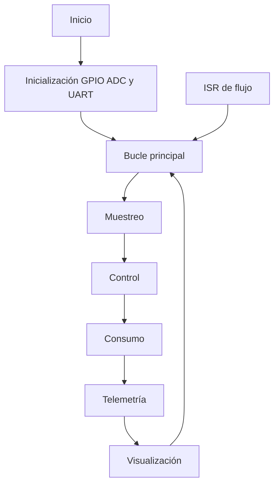
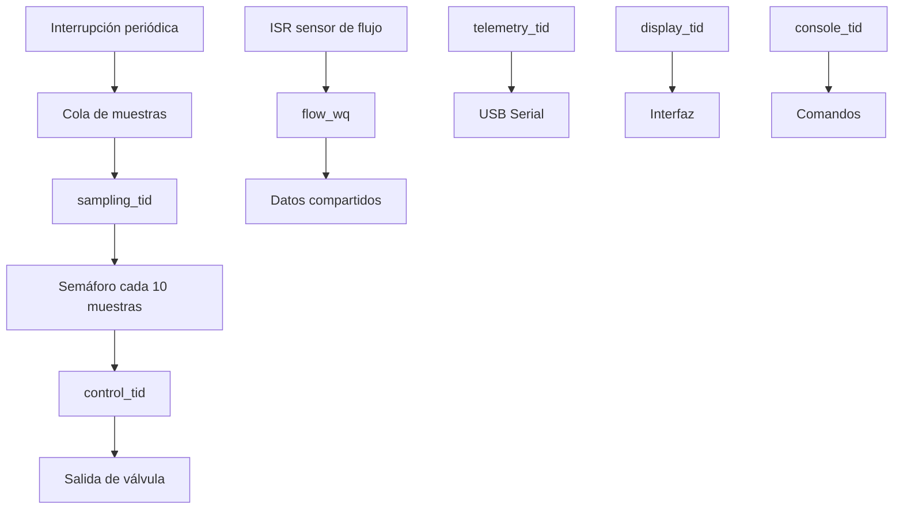

# RET — Informe de Evidencia de Tiempos

**Grupo:** `María Prieto Ortega` `Mariana Zuluaga Yepes`  ·  **Placa:** `Nucleo-L476RG` - `ESP32-C6 Super Mini`
**Plataforma principal:** ESP32-C6 Super Mini  
**RTOS:** Zephyr `4.4.99`  
**Target de compilación:** `esp32c6_devkitc/esp32c6/hpcore`  
**Aplicación:** SoilSense Control  

---

## §1. Requisitos temporales

### 1.1 Requisitos del sistema

| ID | Requisito | Periodo o plazo | Criticidad | Evidencia |
|---|---|---:|---|---|
| REQ-SAMP-01 | Muestrear la presión del sistema. | 1 ms | Alta | Instrumentación GPIO, contadores internos y traza CTF |
| REQ-CTRL-01 | Ejecutar el lazo de control. | 10 ms | Alta | Instrumentación GPIO, contadores internos y traza CTF |
| REQ-CONS-01 | Actualizar el proceso de consumo. | 100 ms | Media | Instrumentación GPIO |
| REQ-TEL-01 | Publicar telemetría. | 1000 ms | Baja | Consola serial |
| REQ-FLOW-01 | Atender los pulsos del sensor de flujo. | Dirigido por eventos | Alta | ISR y cola de trabajo |
| REQ-DISP-01 | Actualizar la interfaz visual. | 500 ms | Baja | Hilo de visualización |
| REQ-SAFE-01 | Llevar el sistema a un estado seguro ante una falla crítica. | Inmediato | Alta | Estado `estop` y salida de válvula |

### 1.2 Inventario acumulativo de tareas

#### Medición de referencia en Nucleo-L476RG

| Tarea | Activación | \(T_i\) | \(D_i\) | \(C_i\) medido | Instrumento |
|---|---|---:|---:|---:|---|
| Muestreo | Periódica | 1 ms | 1 ms | 5,4 µs | GPIO + analizador lógico |
| Control | Periódica | 10 ms | 10 ms | 4,0 µs | GPIO + analizador lógico |
| Consumo | Periódica | 100 ms | 100 ms | 2,0 µs | GPIO + analizador lógico |
| Telemetría | Periódica | 1000 ms | 1000 ms | No determinado | Consola serial |
| Sensor de flujo | Esporádica | Por evento | 5 ms | No determinado | ISR + GPIO |
| Pantalla | Periódica | 500 ms | 500 ms | No determinado | GPIO |

#### Medición acumulativa en ESP32-C6 Super Mini

| Tarea | Activación | \(T_i\) | \(D_i\) | Evidencia temporal | Instrumento |
|---|---|---:|---:|---|---|
| `sampling_tid` | Periódica, liberada por tick | 1 ms | 1 ms | `lat_peak_us`, `samp_jitter_peak_us` y eventos del planificador | `k_cycle_get_32()`, GPIO y CTF |
| `control_tid` | Cada décimo tick | 10 ms | 10 ms | `ctrl_period_peak_us` y eventos de semáforo | `k_cycle_get_32()`, GPIO y CTF |
| `console_tid` | Esporádica | Por comando | No crítico | Estados ready, running y blocked | CTF |
| `telemetry_tid` | Periódica | 1000 ms | 1000 ms | Actividad serial | Consola y CTF |
| `display_tid` | Periódica | 500 ms | 500 ms | Activación del hilo | CTF |
| `flow_wq` | Esporádica | Por evento | 5 ms | Inicio y ejecución de la cola de trabajo | CTF |
| `tracing_thread` | Fondo | Continuo | No aplica | Carga introducida por el observador | CTF |
| `idle` | Fondo | Continuo | No aplica | Porcentaje de CPU disponible | CTF |

> Desde el Lab 5, cada \(C_i\) o valor temporal debe indicar el instrumento con el que fue obtenido. Las mediciones internas, GPIO y CTF no representan necesariamente los mismos límites de tiempo.

---

## Tareas de los laboratorios

### Arquitectura inicial: superloop



La arquitectura inicial concentraba todas las actividades en un único bucle. Esto facilitaba la implementación, pero producía interferencia entre tareas, tiempos de respuesta variables y dificultad para asignar prioridades.

### Arquitectura con kernel



La separación en hilos permite observar directamente qué tarea se ejecuta, cuándo queda lista, cuándo se bloquea y qué tarea recibe el procesador después de una interrupción.

---

## §2. Registro de decisiones de arquitectura

### ADR-001 — Migración del superloop a una arquitectura multihilo

**Estado:** Aceptada.

**Contexto:**  
La implementación inicial ejecutaba muestreo, control, consumo, telemetría y consola dentro de un único superloop. Una actividad larga podía retrasar todas las tareas posteriores.

**Decisión:**  
Separar las actividades principales en hilos de Zephyr, utilizar una cola para entregar muestras y un semáforo para liberar periódicamente el lazo de control.

**Justificación:**

- Permite asignar prioridades.
- Hace explícitas las dependencias.
- Permite bloquear tareas sin consumir CPU.
- Facilita la medición y el análisis de planificabilidad.
- Permite observar preempciones y cambios de contexto.

**Consecuencias:**

- Aumenta el uso de memoria.
- Aparecen costos por cambios de contexto y sincronización.
- Es necesario proteger los datos compartidos.
- El comportamiento deja de ser totalmente secuencial.

---

### ADR-002 — Captura CTF en RAM para el ESP32-C6

**Estado:** Aceptada.

**Contexto:**  
El procedimiento original del Lab 5 utiliza un ESP32-S3 con dos conexiones USB: una para consola y otra para transmitir CTF por UART a 4 Mbaud. El ESP32-C6 Super Mini disponible presenta únicamente `/dev/ttyACM0`, correspondiente al USB Serial/JTAG integrado.

**Decisión:**  
Usar el backend CTF en RAM de Zephyr con un buffer de 65 536 bytes y extraerlo mediante el JTAG integrado utilizando OpenOCD y GDB.

**Configuración empleada:**

```conf
CONFIG_TRACING=y
CONFIG_TRACING_CTF=y
CONFIG_TRACING_BACKEND_RAM=y
CONFIG_RAM_TRACING_BUFFER_SIZE=65536

CONFIG_TRACING_SYSCALL=n
CONFIG_TRACING_TIMER=n
CONFIG_TRACING_MESSAGE_QUEUE=n
CONFIG_TRACING_IDLE=n
```

**Justificación:**

- Conserva los eventos del planificador requeridos por el laboratorio.
- No requiere un segundo adaptador UART.
- Aprovecha el USB Serial/JTAG integrado del ESP32-C6.
- Permite extraer y decodificar una traza CTF válida.

**Consecuencias:**

- La captura no se transmite continuamente.
- El buffer contiene solamente una ventana temporal finita.
- GDB debe detener el procesador para extraer la memoria.
- No se reproduce exactamente la arquitectura de dos puertos del ESP32-S3.
- La extracción por JTAG no debe confundirse con una captura no intrusiva.

**Costo aceptado:**  
Se acepta la captura limitada porque permite demostrar los eventos del planificador y completar el análisis con el hardware disponible.

---

## §3. Evidencia experimental

# Semana 2 — Caracterización del superloop

La primera caracterización se realizó sobre la arquitectura secuencial. La instrumentación GPIO permitió obtener tiempos de ejecución y periodos aproximados de las tareas principales.

### Resultados principales

| Métrica | Resultado |
|---|---:|
| Periodo de muestreo | 1 ms |
| Periodo de control | 10 ms |
| Periodo de consumo | 100 ms |
| Periodo de telemetría | 1000 ms |
| Ejecución de muestreo | 5,4 µs |
| Ejecución de control | 4,0 µs |
| Ejecución de consumo | 2,0 µs |

### Observación

El superloop cumplía en condiciones normales, pero no ofrecía aislamiento temporal. Una operación extensa en consola o telemetría podía retrasar las tareas más críticas.

---

# Semana 3 — Separación del hilo de muestreo

El muestreo fue retirado del superloop y ejecutado en un hilo independiente. Una interrupción periódica libera muestras mediante una cola de mensajes.

### Cadena de activación

```text
Tick periódico
    ↓
ISR
    ↓
k_msgq_put()
    ↓
sampling_tid pasa a ready
    ↓
El planificador selecciona sampling_tid
    ↓
Se ejecuta el muestreo
    ↓
k_msgq_get() bloquea nuevamente el hilo
```

### Resultado

La nueva estructura redujo la dependencia del muestreo respecto de la consola y de otras tareas de menor prioridad.

### Riesgo identificado

La medición interna de latencia no incluye exactamente los mismos límites que una medición externa por GPIO. Por eso ambas deben registrarse como instrumentos diferentes.

---

# Semana 4 — Kernel, prioridades y costo del cambio de contexto

Durante el Lab 4 se terminó de dividir la aplicación en hilos y se instrumentaron las siguientes actividades:

- Muestreo.
- Control.
- Consola.
- Telemetría.
- Visualización.
- Cola de trabajo para el sensor de flujo.
- Hilo idle.

### Configuración base

```conf
CONFIG_GPIO=y
CONFIG_ADC=y
CONFIG_SERIAL=y
CONFIG_CONSOLE=y
CONFIG_UART_CONSOLE=y

CONFIG_MAIN_STACK_SIZE=1536
CONFIG_IDLE_STACK_SIZE=256
CONFIG_ISR_STACK_SIZE=512
CONFIG_SYSTEM_WORKQUEUE_STACK_SIZE=512

CONFIG_THREAD_NAME=y
CONFIG_THREAD_ANALYZER=y
CONFIG_THREAD_ANALYZER_USE_PRINTK=y
```

### Variables de tiempo incorporadas

| Variable | Significado |
|---|---|
| `lat_peak_us` | Máxima latencia interna entre liberación y atención del muestreo |
| `samp_jitter_peak_us` | Máximo jitter observado en el muestreo |
| `ctrl_period_peak_us` | Mayor periodo observado en el lazo de control |
| `ctx_gap_peak_us` | Mayor separación interna asociada con la entrega del procesador |

### Resultado del Lab 4

| Métrica | Valor observado |
|---|---:|
| `lat_peak_us` | 48 µs |
| `samp_jitter_peak_us` | 35–43 µs |
| `ctrl_period_peak_us` | 10 041–10 048 µs |
| `ctx_gap_peak_us` | 74–75 µs |

> Estos valores fueron obtenidos con contadores internos y no equivalen automáticamente al tiempo de un cambio de contexto aislado medido por el analizador lógico.

### Conclusión del Lab 4

La arquitectura multihilo hizo explícita la interferencia entre tareas. El muestreo pudo adquirir mayor prioridad que la consola, mientras que el control fue liberado cada diez muestras mediante un semáforo.

---

# Semana 5 — Tracing: observar el planificador

## 3.5.1 Objetivo

El propósito del Lab 5 fue complementar las mediciones numéricas con una historia del planificador:

- Qué hilo estaba ejecutándose.
- Qué evento hizo ready a otro hilo.
- Cuándo ocurrió la preempción.
- Qué hilo recibió el procesador.
- Cuándo volvió a bloquearse.
- Cuánto perturba el propio tracing.

Debido al hardware disponible, la traza CTF fue almacenada en RAM y extraída mediante USB-JTAG.

---

## 3.5.2 Tarea A — Activación del tracing

### Compilación

```bash
cd ~/zephyrproject
source .venv/bin/activate

west build -p \
  -b esp32c6_devkitc/esp32c6/hpcore \
  /home/maria/4101137-real-time-systems/firmware/superloop -- \
  -DEXTRA_CONF_FILE=trace.conf
```

### Resultado de compilación

```text
Successfully created ESP32-C6 image.
```

La configuración final confirmó:

```text
CONFIG_THREAD_NAME=y
CONFIG_TRACING=y
CONFIG_TRACING_CTF=y
CONFIG_TRACING_BACKEND_RAM=y
CONFIG_RAM_TRACING_BUFFER_SIZE=65536
```

### Extracción del buffer

La traza fue extraída desde `ram_tracing` mediante GDB:

```gdb
dump binary memory /home/maria/zephyrproject/trace/channel0_0 \
    &ram_tracing[0] &ram_tracing[65327]
```

Posteriormente se copió el archivo de metadatos CTF y se abrió la captura con `trace_viewer.py`.

### Resultado de la primera traza

| Propiedad | Resultado |
|---|---:|
| Eventos decodificados | 2761 |
| Hilos reconocidos | 9 |
| Ventana temporal | 3037,547 ms |
| Cambios de entrada registrados | 383 |
| Cambios de salida registrados | 362 |
| Eventos `thread_sched_ready` | 230 |
| Eventos `thread_sched_pend` | 166 |
| Entradas a ISR | 186 |
| Salidas de ISR | 183 |

### Hilos identificados

```text
sampling_tid
idle
console_tid
control_tid
display_tid
tracing_thread
telemetry_tid
flow_wq
main
```

### Evidencia de la Tarea A

La vista Gantt mostró carriles con nombres de hilos, estados `running`, `ready`, `blocked` y `sleep`, además de los eventos de ISR.

**Resultado:** Tarea A completada. El tracing CTF funciona y los hilos son identificables por nombre.

---

## 3.5.3 Tarea B — Historia de una preempción

La captura específica de `calib` produjo:

| Propiedad | Resultado |
|---|---:|
| Eventos | 2764 |
| Hilos visibles en la ventana | 5 |
| Duración | 3136,906 ms |
| Backend | CTF en RAM |
| Tamaño del buffer | 65 536 bytes |

### Identificación de hilos por dirección

| Dirección | Hilo |
|---|---|
| `0x40810288` | `sampling_tid` |
| `0x408103c0` | `console_tid` |
| `0x40810150` | `control_tid` |
| `0x40810a30` | `idle` |

### Tick seleccionado

| Instante | Evento | Interpretación |
|---:|---|---|
| 815,125 µs | `isr_enter` | Comienza la ISR del tick |
| 826,500 µs | `thread_sched_ready` de `console_tid` | La consola queda lista |
| 843,000 µs | `thread_sched_ready` de `sampling_tid` | La muestra queda disponible |
| 855,500 µs | `isr_exit` | Finaliza la ISR |
| 866,375 µs | `thread_switched_out` de `idle` | Idle entrega la CPU |
| 876,313 µs | `thread_switched_in` de `sampling_tid` | Muestreo comienza a ejecutar |
| 888,313 µs | `gpio_port_set_bits_raw_enter` | Sube `instr_samp` |
| 936,375 µs | `thread_sched_pend` de `sampling_tid` | Muestreo vuelve a esperar |
| 948,813 µs | `thread_switched_out` de `sampling_tid` | Muestreo deja la CPU |
| 963,188 µs | `thread_switched_in` de `console_tid` | La consola continúa |

### Cadena observada

```text
Tick ISR
  → console_tid ready
  → sampling_tid ready
  → fin de ISR
  → idle sale
  → sampling_tid entra
  → instr_samp sube
  → sampling_tid queda pendiente
  → sampling_tid sale
  → console_tid entra
```

En el tick elegido, la tarea que estaba ejecutándose antes de la ISR era `idle`. La consola estaba lista, pero no estaba ejecutándose justo antes de la activación. Por lo tanto, la captura demuestra una entrega completa del procesador y la selección prioritaria de muestreo, aunque no reproduce literalmente una consola ejecutándose y siendo interrumpida.

### Tiempos derivados

| Medición | Operación | Resultado |
|---|---|---:|
| ISR → entrada de muestreo | 876,313 − 815,125 µs | 61,188 µs |
| ISR → subida de `instr_samp` | 888,313 − 815,125 µs | 73,188 µs |
| Muestreo ready → running | 876,313 − 843,000 µs | 33,313 µs |
| Cambio idle → muestreo | 876,313 − 866,375 µs | 9,938 µs |
| Cambio muestreo → consola | 963,188 − 948,813 µs | 14,375 µs |
| Ejecución visible antes de bloquearse | 936,375 − 876,313 µs | 60,062 µs |

### Comparación con las métricas internas

| Fuente | Valor | Límites medidos |
|---|---:|---|
| Traza CTF | 61,188 µs | `isr_enter` → `sampling_tid switched_in` |
| Traza CTF + GPIO instrumentado | 73,188 µs | `isr_enter` → inicio de `instr_samp` |
| `lat_peak_us` con tracing | 48 µs | Límites internos definidos en el firmware |
| `ctx_gap_peak_us` con tracing | 75 µs | Mayor separación interna acumulada |
| Cambio de contexto visible | 9,938 µs | `idle switched_out` → `sampling switched_in` |

Los valores difieren porque cada instrumento y cada métrica utilizan puntos iniciales y finales distintos. No es correcto comparar 9,938 µs con 75 µs como si fueran la misma magnitud.

---

### Décimo tick: liberación del control

En el décimo tick, el muestreo ejecutó `k_sem_give()` y liberó el hilo de control.

| Instante | Evento | Interpretación |
|---:|---|---|
| 408,815 ms | `isr_enter` | Tick periódico |
| 408,827 ms | `console_tid ready` | Consola lista |
| 408,843 ms | `sampling_tid ready` | Muestreo listo |
| 408,856 ms | `isr_exit` | Termina ISR |
| 408,876 ms | `sampling_tid switched_in` | Ejecuta muestreo |
| 408,931 ms | `semaphore_give_enter` | Muestreo entrega semáforo |
| 408,940 ms | `control_tid ready` | Control queda listo |
| 408,948 ms | `semaphore_give_exit` | Termina la entrega |
| 408,961 ms | `sampling_tid pend` | Muestreo se bloquea |
| 408,974 ms | `sampling_tid switched_out` | Muestreo deja la CPU |
| 408,988 ms | `control_tid switched_in` | El control recibe la CPU |
| 408,996 ms | `semaphore_take_exit` | Control obtiene el semáforo |
| 409,004 ms | GPIO de control | Inicio de la ejecución instrumentada |
| 409,031 ms | `semaphore_take_enter` | Control vuelve a esperar |
| 409,038 ms | `semaphore_take_blocking` | Semáforo no disponible |
| 409,050 ms | `control_tid pend` | Control queda bloqueado |
| 409,064 ms | `control_tid switched_out` | Control entrega la CPU |
| 409,077 ms | `console_tid switched_in` | Regresa la consola |

### Cadena del décimo tick

```text
ISR
  → sampling_tid
  → k_sem_give()
  → control_tid ready
  → sampling_tid se bloquea
  → control_tid ejecuta
  → k_sem_take()
  → control_tid se bloquea
  → console_tid continúa
```

### Tiempo desde `k_sem_give()` hasta control

```text
408,988 ms − 408,931 ms = 57 µs
```

### Tiempo desde `control_tid ready` hasta ejecución

```text
408,988 ms − 408,940 ms = 48 µs
```

---

## 3.5.4 Ventana de captura y saturación

En el montaje original del ESP32-S3 se esperaba conservar aproximadamente los primeros 75 ms de `calib` cuando el hilo de transmisión quedaba sin CPU y el buffer se llenaba.

En el ESP32-C6 se utilizó un buffer CTF en RAM. La captura alcanzó aproximadamente 3,137 s antes de llenar sus 65 536 bytes.

GDB confirmó:

```text
pos = 65331
buffer_full = true
```

### Interpretación

El buffer conserva una ventana finita porque:

1. Los eventos se almacenan en RAM.
2. No existe transmisión continua por un segundo puerto.
3. Cada ISR, cambio de contexto y operación instrumentada consume espacio.
4. Al llenarse el buffer, ya no se pueden conservar eventos adicionales.
5. La duración observada depende de la tasa de eventos y no únicamente del tiempo real.

Por eso el resultado no fue exactamente 75 ms. La causa física es la misma —capacidad finita del observador—, pero el backend y la tasa de eventos son diferentes.

---

## 3.5.5 Carga de CPU observada

Durante la captura de calibración, el visor presentó:

| Hilo o estado | Uso de CPU |
|---|---:|
| `sampling_tid` | 56 % |
| `idle` | 23 % |
| `console_tid` | 13 % |
| `control_tid` | 6 % |
| `display_tid` | 0 % |
| CPU ocupada indicada | 75 % |

La suma visible es aproximadamente 98 %. La diferencia respecto al 100 % se explica por redondeo, ISR, eventos de inicialización y actividad del tracer no mostrada como una categoría independiente en esa ventana.

### Interpretación

- El muestreo domina el uso de CPU durante `calib`.
- El 23 % de idle muestra que aún existe margen de procesador.
- La consola y el control consumen una fracción menor.
- El tracing también consume CPU y memoria, aunque su costo no siempre aparece como una línea porcentual independiente.

---

## 3.5.6 Tarea C — Precio de observar

Para estimar la perturbación se compararon dos compilaciones:

1. Firmware con tracing CTF activo.
2. Firmware normal sin `trace.conf`.

Antes de cada medición se ejecutó:

```text
timing reset
status
```

### Resultados

| Métrica | Tracing activo | Tracing desactivado | Diferencia |
|---|---:|---:|---:|
| `lat_peak_us` | 48 µs | 12 µs | +36 µs |
| `samp_jitter_peak_us` | 43 µs | 7 µs | +36 µs |
| `ctrl_period_peak_us` | 10 048 µs | 10 005 µs | +43 µs |
| `ctx_gap_peak_us` | 75 µs | 15 µs | +60 µs |

### Sobrecosto sobre el jitter máximo

\[
\Delta J = J_{\text{on}} - J_{\text{off}}
\]

\[
\Delta J = 43\ \mu s - 7\ \mu s = 36\ \mu s
\]

### Factor de incremento

\[
\frac{43}{7} = 6,14
\]

El jitter máximo con tracing fue aproximadamente 6,14 veces el valor sin tracing.

### Incremento porcentual

\[
\frac{43-7}{7}\times100 = 514,3\%
\]

### Interpretación

El tracing introduce trabajo adicional por cada evento registrado:

- Escritura del identificador del evento.
- Escritura de marcas de tiempo.
- Escritura de parámetros.
- Actualización del buffer CTF.
- Instrumentación adicional de GPIO y del kernel.

La traza permite explicar el comportamiento del planificador, pero altera el sistema observado. Por eso debe emplearse junto con una medición menos intrusiva.

---

## 3.5.7 Tabla de mediciones del Lab 5

| Medición | Predicción | Valor obtenido | Contraste |
|---|---:|---:|---|
| Cambio de contexto según la traza | ≤ 20 µs | 9,938 µs | `ctx_gap_peak_us` sin tracing: 15 µs |
| Tick ISR → inicio de muestreo | ≤ 75 µs | 73,188 µs | `lat_peak_us` con tracing: 48 µs |
| Carga de CPU por hilo | Muestreo dominante e idle presente | sampling 56 %, idle 23 %, consola 13 %, control 6 %, display 0 % | Total visible ≈ 98 % |
| Sobrecosto de tracing en jitter máximo | ≤ 40 µs | +36 µs | 43 µs con tracing frente a 7 µs sin tracing |

---

## 3.5.8 Contraste entre instrumentos

| Instrumento | Qué muestra | Ventaja | Limitación |
|---|---|---|---|
| GPIO + analizador lógico | Bordes eléctricos y duración real de pulsos | Muy baja perturbación | No explica qué hilo causó el evento |
| CTF | Hilos, ISR, ready, blocked, switches y sincronización | Explica la historia del planificador | Introduce carga y usa memoria |
| `k_cycle_get_32()` | Diferencias internas entre puntos específicos del código | Fácil de automatizar | Depende de dónde se coloquen las marcas |
| Consola serial | Resultados agregados | Fácil de registrar | Imprimir también puede perturbar |

En este laboratorio no se dispuso de un analizador lógico externo. La comparación de tracing activo y desactivado se realizó con los contadores internos del firmware. Los GPIO quedaron instrumentados para una validación externa posterior.

---

## 3.5.9 Evidencias seleccionadas

### Evidencia A — Tracing activo y nombres de hilos

La vista Gantt muestra:

```text
sampling_tid
idle
console_tid
control_tid
display_tid
[ISR]
```

También muestra:

```text
events = 2761
threads = 9
window = 3037.547 ms
```

### Evidencia B1 — Preempción del muestreo

Secuencia seleccionada:

```text
815.125 µs  isr_enter
843.000 µs  sampling_tid ready
855.500 µs  isr_exit
866.375 µs  idle switched_out
876.313 µs  sampling_tid switched_in
888.313 µs  instr_samp set
936.375 µs  sampling_tid pend
948.813 µs  sampling_tid switched_out
963.188 µs  console_tid switched_in
```

### Evidencia B2 — Décimo tick

Secuencia seleccionada:

```text
408.815 ms  isr_enter
408.843 ms  sampling_tid ready
408.876 ms  sampling_tid switched_in
408.931 ms  semaphore_give_enter
408.940 ms  control_tid ready
408.974 ms  sampling_tid switched_out
408.988 ms  control_tid switched_in
409.038 ms  semaphore_take_blocking
409.064 ms  control_tid switched_out
409.077 ms  console_tid switched_in
```

### Evidencia C — Tracing activo

```text
lat_peak_us=48
samp_jitter_peak_us=43
ctrl_period_peak_us=10048
ctx_gap_peak_us=75
```

### Evidencia C — Tracing desactivado

```text
lat_peak_us=12
samp_jitter_peak_us=7
ctrl_period_peak_us=10005
ctx_gap_peak_us=15
```

---

## 3.5.10 Conclusiones del Lab 5

1. Se consiguió una traza CTF válida en el ESP32-C6 Super Mini usando almacenamiento en RAM y extracción por JTAG.

2. La traza identificó directamente los hilos y los cambios de estado del planificador.

3. El tiempo visible entre la salida de idle y la entrada de muestreo fue de 9,938 µs.

4. El tiempo entre la entrada de la ISR y la subida de `instr_samp` fue de 73,188 µs.

5. En el décimo tick, `k_sem_give()` dejó listo al hilo de control, que comenzó a ejecutarse 48 µs después de quedar ready.

6. La captura mostró que el hilo de muestreo vuelve a bloquearse y permite continuar al control o a la consola.

7. El tracing aumentó el jitter máximo de muestreo de 7 µs a 43 µs, con un sobrecosto de 36 µs.

8. CTF explica quién ejecutó y por qué, mientras que GPIO o un analizador lógico son más apropiados para juzgar los tiempos físicos con menor perturbación.

9. La captura en RAM no reproduce el streaming UART de 4 Mbaud del ESP32-S3, pero conserva el objetivo académico de observar el planificador.

---

## §4. Análisis de planificabilidad

### 4.1 Utilización de referencia

Para tareas periódicas independientes:

\[
U = \sum_i \frac{C_i}{T_i}
\]

Usando las mediciones iniciales disponibles:

\[
U =
\frac{5,4}{1000}
+
\frac{4,0}{10000}
+
\frac{2,0}{100000}
\]

\[
U = 0,0054 + 0,0004 + 0,00002
\]

\[
U = 0,00582
\]

\[
U = 0,582\%
\]

Este cálculo representa solamente los cuerpos instrumentados de las tareas y no incluye:

- ISR.
- Cambios de contexto.
- Operaciones de kernel.
- Consola.
- Telemetría.
- Tracing.
- Accesos a periféricos.
- Secciones críticas.

### 4.2 Costo del tracing

El Lab 5 demostró que el costo del observador debe incluirse en cualquier análisis experimental.

La métrica más sensible fue:

\[
J_{\text{off}} = 7\ \mu s
\]

\[
J_{\text{on}} = 43\ \mu s
\]

\[
\Delta J = 36\ \mu s
\]

Por tanto, las mediciones utilizadas para un análisis de planificabilidad deben indicar si fueron tomadas con tracing activo o desactivado.

### 4.3 Estado actual

Los periodos de 1 ms y 10 ms se mantienen dentro de sus plazos en las capturas realizadas. Sin embargo, el análisis formal deberá incorporar:

- Peor caso de ejecución de cada hilo.
- Bloqueos.
- Interferencia de tareas de mayor prioridad.
- Costos del kernel.
- ISR.
- Tracing, cuando esté habilitado.
- Acceso a recursos compartidos.

---

## §5. Seguridad y comportamiento degradado

### Estado seguro

Ante una condición crítica:

- La válvula debe pasar a un estado seguro.
- `estop` debe activarse.
- El control no debe continuar aplicando una salida peligrosa.
- La telemetría debe informar la condición cuando sea posible.

### Riesgos temporales

| Riesgo | Efecto | Mitigación |
|---|---|---|
| Consola prolongada | Retraso de tareas | Prioridad inferior a muestreo y control |
| Buffer de muestras lleno | Pérdida de muestras | Supervisar backlog y dimensionar la cola |
| Tracing activo | Incremento de jitter | Usarlo solamente durante diagnóstico |
| Saturación del buffer CTF | Pérdida de eventos posteriores | Capturas cortas y extracción frecuente |
| Bloqueo de recurso compartido | Inversión de prioridad | Reducir secciones críticas |
| Pérdida del sensor | Control incorrecto | Activar estado seguro |
| JTAG conectado durante operación | Detención del nodo | No utilizarlo durante operación de campo |

### Política de instrumentación

- GPIO y analizador lógico: medición temporal externa.
- CTF: diagnóstico del planificador.
- Contadores internos: supervisión automática.
- Consola: presentación de resultados agregados.

Los instrumentos deben activarse solamente cuando su costo sea aceptable para el escenario de prueba.

---

## Estado acumulativo del proyecto

| Laboratorio | Resultado |
|---|---|
| Lab 2 | Caracterización inicial del superloop |
| Lab 3 | Separación del hilo de muestreo |
| Lab 4 | Arquitectura multihilo, prioridades y métricas internas |
| Lab 5 | Tracing CTF, preempción, décimo tick, carga de CPU y costo del observador |

El proyecto queda preparado para continuar con el análisis formal de planificabilidad utilizando tanto las mediciones temporales como la historia observada del planificador.
